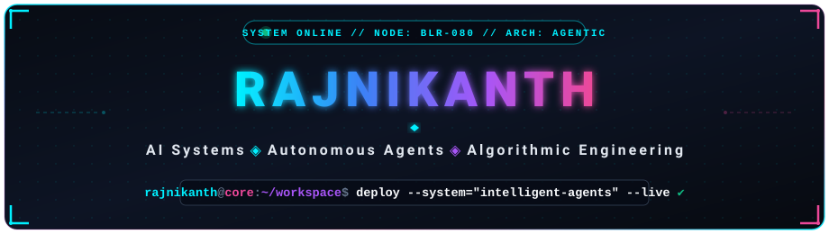

<div align="center">

  <!-- Self-hosted Vector Header Banner -->
  <a href="https://github.com/Rajnikanth31">
    
  </a>

  <br/><br/>

  <!-- Dynamic Typing Subtitle -->
  <a href="https://github.com/Rajnikanth31">
    
  </a>

  <br/><br/>

  <!-- Quick Badges -->
  <a href="https://github.com/Rajnikanth31?tab=repositories">
    
  </a>
  <a href="https://github.com/Rajnikanth31">
    
  </a>
  <a href="mailto:rajnikanth31@gmail.com">
    
  </a>

</div>

<br/>

### ⚡ About Me

```yaml
identity: Rajnikanth
role: Full-Stack Developer & Systems Builder
location: Bangalore, India
focus:
  - Autonomous AI Agents & Intelligent Tooling
  - High-throughput Backends & Trading Architectures
  - Interactive Developer Experiences & Knowledge Graphs
passions: [Open-Source, Clean Architectures, Generative AI]
```

---

### 🛠️ Tech Stack & Arsenal

<div align="center">

  #### Languages & Frameworks
  <a href="https://skillicons.dev">
    
  </a>

  <br/>

  #### Tools, Databases & DevOps
  <a href="https://skillicons.dev">
    
  </a>

</div>

---

### 🚀 Highlighted Projects

| Project | Description | Stack |
| :--- | :--- | :--- |
| **[AI-Trader](https://github.com/Rajnikanth31/AI-Trader)** | Agent-native fully automated algorithmic trading system. | `Python` `AI Agents` `Trading` |
| **[Understand-Anything](https://github.com/Rajnikanth31/Understand-Anything)** | Turns codebases into interactive knowledge graphs for AI assistants. | `TypeScript` `Graph` `DevTools` |
| **[postiz-cheap](https://github.com/Rajnikanth31/postiz-cheap)** | Self-hosted social media scheduler with AI-powered post writer. | `TypeScript` `AI` `FullStack` |
| **[resumeflow](https://github.com/Rajnikanth31/resumeflow)** | Modern resume builder and automated applicant workflow system. | `TypeScript` `React` `Tailwind` |

---

### 📊 GitHub Analytics & Activity

<div align="center">

  
  

  <br/><br/>

  

</div>

---

### 🌐 Connect With Me

<div align="center">

  <a href="mailto:rajnikanth31@gmail.com">
    
  </a>
  &nbsp;
  <a href="https://github.com/Rajnikanth31">
    
  </a>

</div>

<br/>

<div align="center">
  <sub>⚡ Designed with dark cyberpunk aesthetics for Rajnikanth's GitHub Profile.</sub>
</div>
